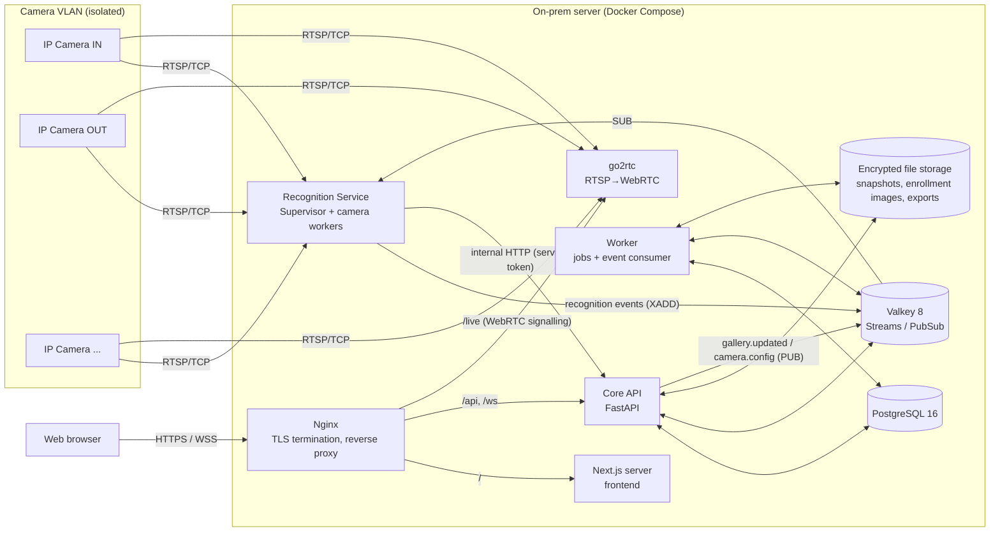
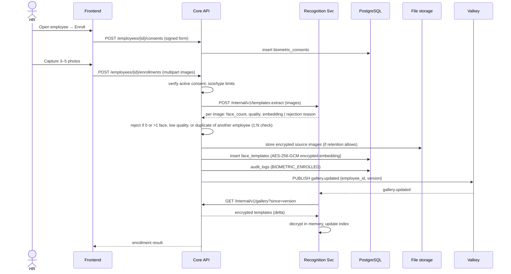
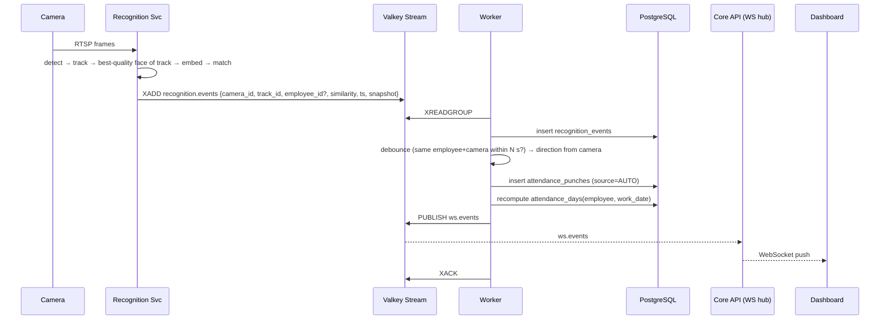
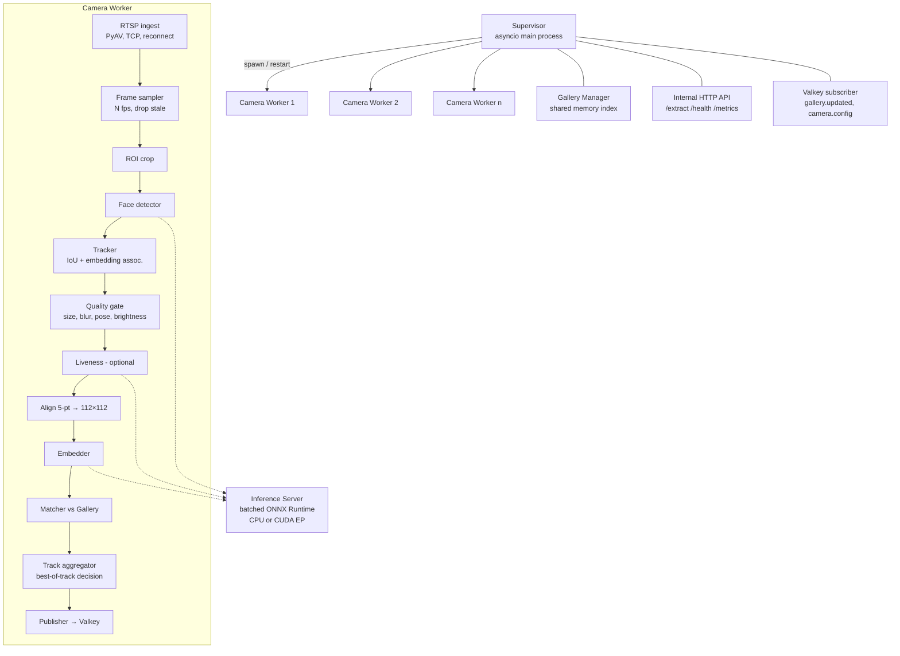
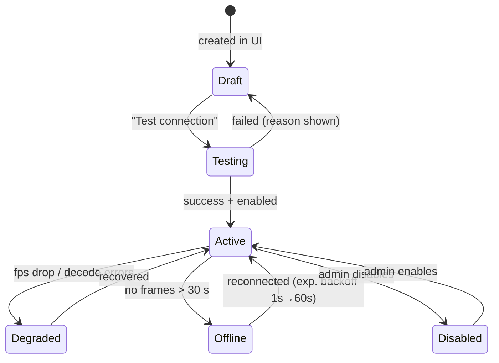

# Architecture — AI Employee Attendance

> Status: **Proposal (Phase 1)**, awaiting approval. Decisions marked **[DECISION NEEDED]** require the project owner's input.

Contents
1. System architecture
2. Component responsibilities (frontend / backend / AI)
3. Data flows
4. AI recognition service architecture
5. Camera integration design
6. Attendance engine
7. Authentication and authorization
8. Security architecture
9. Biometric privacy requirements
10. AI model licensing
11. Technology compatibility issues
12. Architectural risks
13. Deployment and operations

---

## 1. System architecture

### 1.1 Style

This is a **modular monolith plus one specialised AI service**. It is not microservices. At this scale (≤ 2k employees, ≤ 32 cameras) microservices would add operational cost without benefit. The split exists only where the runtime profile genuinely differs:

- **Core API.** Request/response, business rules, owns the database.
- **Recognition service.** Long-running, CPU/GPU-bound video processing. It has **no database access**.
- **Worker.** Scheduled and background jobs (daily attendance computation, retention purges, report exports). It shares the Core API codebase but runs as a separate process.

### 1.2 Container diagram



### 1.3 Why these choices

| Decision | Rationale | Alternatives considered |
|----------|-----------|-------------------------|
| Python for both API and AI | One language, shared Pydantic models for event contracts, a team only needs Python + TS | NestJS API + Python AI (two backend stacks to maintain) |
| FastAPI | Async, OpenAPI generated automatically, Pydantic v2 validation | Django (heavier, sync ORM), Flask (less structure) |
| PostgreSQL 16 | Relational integrity for HR data, partitioning for event tables, JSONB for settings | MySQL (weaker partitioning and JSON) |
| **No pgvector** in v1 | 2k employees × 5 templates × 512 floats ≈ 20 MB, so in-memory brute-force cosine search in NumPy takes < 2 ms. This also lets templates stay **encrypted at rest** (pgvector cannot search encrypted vectors). | pgvector (reconsider above ~50k templates) |
| Valkey Streams | Durable, ordered event queue with consumer groups and replay; also gives Pub/Sub and cache. One dependency. | RabbitMQ/Kafka (overkill), Redis ≥ 7.4 (licence change, see §11) |
| go2rtc | Single binary, MIT licence, RTSP→WebRTC/MSE with low latency, no transcoding for H.264 | MediaMTX (also good, MIT), HLS (5–10 s latency) |
| Docker Compose | Single-server on-prem target; simple for local IT staff | Kubernetes (unnecessary at this scale) |

---

## 2. Component responsibilities

### 2.1 Frontend (Next.js)

Stack (approved in Phase 2, replacing the Phase 1 React + Vite + Ant Design proposal): **Next.js 16 (App Router) · React 19 · TypeScript · Tailwind CSS 4**.
Next.js is used as the UI server only. **All business logic and data access stay in the FastAPI Core API.** Next.js route handlers / server actions must not talk to PostgreSQL directly. The browser calls the Core API (`/api/v1`) through Nginx on the same origin in production.

| Responsibility | Notes |
|----------------|-------|
| Authentication UI | Login, MFA prompt, password change, session expiry handling (silent refresh) |
| Role-aware navigation | Menu and routes hidden by role. **The backend still enforces every permission.** |
| Employee management | CRUD, department tree, positions, bulk import (XLSX) |
| Enrollment wizard | Consent capture (signed PDF upload or checkbox + printed form), webcam capture with live face-quality hints, upload fallback |
| Camera management | Add/edit/test camera, ROI polygon editor on a snapshot, direction setting, health status |
| Live view | WebRTC player per camera via go2rtc, live recognition overlay feed via WebSocket |
| Attendance | Daily board, employee timeline, timesheet grid, corrections, leave |
| Reports | Filter, preview, request export, download |
| Settings | Recognition thresholds (super admin), retention periods, holidays, schedules |
| i18n | uz-Latn, ru, en; all dates shown in the site timezone |


#### Frontend foundation (implemented in Phase 7)

**Structure** (`apps/web/src`):

| Path | Purpose |
|------|---------|
| `app/login/` | Public login page (real backend login) |
| `app/(app)/` | Authenticated area. `layout.tsx` wraps every page in `AppShell` (sidebar + top bar + client-side guard). |
| `app/(app)/*` | Complete pages since Phase 8. Page → endpoint map in DEVELOPMENT_PROGRESS (Phase 8). Missing backend dependencies are shown with `MissingApi` panels listing the exact planned endpoints. |
| `app/(app)/design-system/` | Living style guide, **development builds only** (404 in production) |
| `components/ui/` | Design-system components |
| `components/layout/` | `AppShell`, `Sidebar`, `Topbar`, `nav.ts` (permission-filtered menu) |
| `components/entities.tsx` | Domain widgets: status badges, Department/Schedule selects, `EmployeePicker` (async combobox), `AuthImage` (Bearer-loaded images), `MissingApi` |
| `components/attendance/day-detail.tsx` | Day detail + atomic correction form (shared by Attendance and History) |
| `lib/{types,labels,errors,time,validation,reports}.ts` | Contract types; enum labels; server-error → field/message mapping; Tashkent time helpers; client validation mirroring server rules; timesheet + CSV |
| `lib/api.ts` | API client: in-memory access token, single-flight refresh, Problem Details → `ApiError` |
| `lib/auth.tsx` | `AuthProvider` / `useAuth()` (status, user, permissions, login, logout) |
| `lib/use-api.ts` | `useApiQuery(path)`: the standard data-loading hook (loading / error / reload) |
| `lib/i18n.ts` | UI strings (Uzbek Latin). Every user-visible string lives here. |
| `lib/format.ts` | Dates and times always in the organisation time zone (Asia/Tashkent) |

**Auth flow in the browser:**
1. Login keeps the access token in memory only. The refresh token is an HttpOnly cookie.
2. A page reload calls `/auth/refresh` (single-flight) to restore the session.
3. On `401 TOKEN_EXPIRED`, the client makes one refresh and one retry.
4. Any other 401 means the session ended: the app goes to `/login`, which says "Sessiya tugadi".
5. `?next=` only accepts same-app paths (open-redirect protection).
6. Menu items are hidden when the role lacks the permission. **The server enforces every permission regardless.**

**Design system:**

| Token group | Values |
|-------------|--------|
| Navy | `navy-50…950` (sidebar `navy-950`, primary buttons `navy-800`, headings `navy-900`) |
| Accent | `brand-50…700` (subtle blue: focus rings, links, active icons) |
| Neutrals | `canvas` (app background, light gray), `surface` (white cards), `subtle`, `line` (borders), `ink`, `muted` |
| Status | `success`, `warning`, `danger`, `info` (50 / 600 / 700) |
| Type | System fonts only (on-prem, no font CDN). Tabular numbers for figures. |

| Component | Notes |
|-----------|-------|
| `Button` | variants primary / secondary / ghost / danger / link; sizes sm / md / lg / icon; `loading` disables and sets `aria-busy`; default `type="button"` |
| `Card`, `CardHeader`, `CardBody`, `StatCard` | KPI tiles with tone icons |
| `DataTable`, `Pagination` | Built-in loading skeleton / error with retry / empty states; columns can hide on mobile; horizontal scroll |
| `Modal` | `role=dialog`, `aria-modal`, labelled; Esc / backdrop close; focus trap; focus restore; scroll lock; bottom sheet on phones |
| `Field`, `Input`, `Select`, `Textarea`, `Checkbox`, `PasswordInput`, `FormError` | Label/hint/error wired with `aria-describedby` / `aria-invalid` |
| `ToastProvider` / `useToast()` | success / info / warning auto-dismiss after 5 s; errors persist (`role=alert`); max 4 visible |
| `Alert`, `Badge` | Inline persistent messages; status pills |
| `LoadingState`, `SkeletonRows`, `Skeleton`, `Spinner`, `EmptyState`, `ErrorState` | `ErrorState` explains network / 403 / API errors |
| `DevPlaceholder` | Dashed amber "ISHLAB CHIQILMOQDA · <phase>" panel. **The only allowed way** to show unbuilt features. |

Responsive: fixed sidebar from `lg` (1024 px); below that a slide-in drawer (Esc / backdrop closes). Tables scroll horizontally. Modals become bottom sheets on phones. Accessibility: visible focus ring everywhere, skip-to-content link, `prefers-reduced-motion` respected. The UI is light-only by design.

Next.js specifics: authenticated pages render client-side only (the token is in memory), so `(app)/layout.tsx` sets `instant = false` and `next.config.ts` uses `instantInsights.validationLevel = "manual-warning"`. The public login page opts in with `instant = true`. Error boundaries use the Next 16 `retry()` prop.

The frontend **never** receives face embeddings. It receives enrollment images and snapshots only through short-lived, authorised URLs.

### 2.2 Core API (FastAPI)

| Module | Responsibility |
|--------|----------------|
| `auth` | Login, JWT issue/refresh/revoke, MFA (TOTP), password policy, lockout |
| `users` | System user accounts, role assignment |
| `org` | Sites, departments, positions |
| `employees` | Employee master data, lifecycle (hire, terminate, which triggers biometric purge) |
| `biometrics` | Consent records, enrollment orchestration (calls Recognition `/enroll`), template encryption and storage, gallery export to the recognition service |
| `cameras` | Camera CRUD, credential encryption, connection test, config push to recognition service and go2rtc |
| `recognition` | Ingest of recognition events (stream consumer runs in Worker), event query, unknown-face review |
| `attendance` | Punches, daily records, corrections, recomputation |
| `schedules` | Schedules, rules, assignments, holidays |
| `leave` | Leave types, requests, approvals |
| `reports` | Report queries, async export jobs |
| `audit` | Append-only audit writer and query |
| `settings` | Typed system settings |
| `realtime` | WebSocket hub that relays live events to authorised clients |

### 2.3 Worker (same codebase, separate process)

- **Event consumer.** Reads the `recognition.events` stream (consumer group), persists `recognition_events`, applies debounce/direction rules, creates `attendance_punches`, triggers day recomputation, and publishes to the WebSocket hub.
- **Scheduler** (APScheduler):
  - nightly close-of-day computation (marks ABSENT, INCOMPLETE)
  - retention purges (snapshots, events, revoked or terminated biometrics)
  - camera health aggregation
  - report export jobs

### 2.4 Recognition service

- Supervises one worker per enabled camera.
- Ingests RTSP, detects, tracks, quality-gates, (optionally) checks liveness, embeds and matches against the in-memory gallery.
- Publishes **decisions** (matched, unknown, rejected) to Valkey. It **never decides attendance**; it only reports sightings.
- Exposes an internal HTTP API for enrollment (image → template) and health.
- Holds templates **only in memory**, decrypted with a key it receives at start-up. It never writes them to disk.

---

## 3. Key data flows

### 3.1 Enrollment



### 3.2 Recognition to attendance



**Idempotency.** Every event carries `event_uid` (UUIDv7 generated by the recognition service). `recognition_events.event_uid` is UNIQUE, so stream redelivery cannot create duplicate punches.

---

## 4. AI recognition service architecture

### 4.1 Internal structure



- **Process model.** One OS process per camera handles decode and tracking, which isolates crashes and the GIL. A **shared inference process** batches detection and embedding requests from all workers so a GPU is used efficiently (one model copy in VRAM). On CPU-only hosts, inference runs in-process per worker.
- **Pluggable engine.** All models sit behind interfaces so the licensing decision (§10) does not affect the rest of the code:

```python
class FaceDetector(Protocol):
    def detect(self, frames: list[np.ndarray]) -> list[list[Detection]]: ...   # bbox, 5 landmarks, score

class FaceEmbedder(Protocol):
    model_id: str            # e.g. "arcface-r100@1.0"; stored with each template
    dim: int
    def embed(self, aligned: list[np.ndarray]) -> np.ndarray: ...             # L2-normalised (n, dim)

class LivenessChecker(Protocol):
    def score(self, frame: np.ndarray, det: Detection) -> float: ...
```

### 4.2 Pipeline parameters (initial defaults, all configurable per camera)

| Stage | Default | Purpose |
|-------|---------|---------|
| Sampling | 5 fps for recognition | Enough for walking speed; keeps CPU low |
| Min face size | 80 px face width (≈ 40 px inter-ocular) | Below this, accuracy collapses |
| Blur | Laplacian variance ≥ 60 | Rejects motion blur |
| Pose | \|yaw\| ≤ 30°, \|pitch\| ≤ 25° | Frontal-ish faces only |
| Track window | Up to 2 s or 10 faces per track | Pick best 3 by quality, average embeddings |
| Match threshold | Calibrated per model (§4.4); placeholder cosine 0.45 | 1:N decision |
| Margin rule | top1 − top2 ≥ 0.05 | Rejects ambiguous matches (look-alikes, twins) |
| Liveness | Off by default; threshold 0.8 when on | Photo/screen attack resistance |

### 4.3 Decision outputs

| Decision | Meaning | Creates a punch? |
|----------|---------|------------------|
| `MATCHED` | similarity ≥ threshold, margin OK, liveness OK | Yes (subject to debounce) |
| `UNKNOWN` | Good-quality face, no match | No. Stored for review (if enabled) |
| `AMBIGUOUS` | Above threshold but margin too small | No. Stored for review |
| `SPOOF_SUSPECTED` | Liveness failed | No. Raises an alert |
| `LOW_QUALITY` | Never reached quality gate across track | No. Counted in metrics only (not stored) |

### 4.4 Accuracy engineering

- **Threshold calibration is mandatory before go-live.** Collect a pilot dataset at the real cameras (with consent) and plot FAR/FRR. Choose the threshold for FAR ≤ 0.1%.
- **Model version pinning.** Each `face_templates` row stores `model_id`. Templates from different models are **not comparable**. A model upgrade requires re-extraction from stored enrollment images, which is why we keep encrypted enrollment images (see §9 trade-off).
- **Duplicate detection at enrollment.** A new employee's template is 1:N searched. A high similarity to an existing employee blocks enrollment until HR resolves it.
- **Gallery drift.** Optionally add high-confidence live captures as extra templates (limited, opt-in, off by default). Appearance changes such as beards and glasses then degrade accuracy less.

### 4.4a Implementation status (Phase 9)

Implemented in `apps/recognition` as a single-image engine. There are no camera workers, tracker or liveness yet:
`detect (YuNet) → quality pre-check → align → quality post-check → embed (SFace) → match → decide`.
The implemented defaults differ slightly from §4.2. All of them are configurable and **must be calibrated by the evaluation**:
- blur variance ≥ 40, measured on the aligned 112×112 crop;
- inter-ocular distance ≥ 28 px;
- |roll| ≤ 20°;
- threshold = SFace reference 0.363, margin 0.05;
- an **uncertain band** of 0.03 above the threshold, which yields AMBIGUOUS.

Pitch cannot be estimated from 5 landmarks. The service is **not connected** to attendance (gate: EVALUATION_PROTOCOL.md).

### 4.5 Performance budget (estimates; validate in Phase 4)

| Hardware | Rough capacity at 5 fps sampling |
|----------|----------------------------------|
| 8-core modern CPU, no GPU | ~6–8 cameras |
| NVIDIA RTX 3060/4060 class (8–12 GB) | ~24–32 cameras |
| Decode | Use main stream (for face pixels); prefer hardware decode (NVDEC) when GPU present |

Measured in Phase 9 on the development PC (CPU only): YuNet on a full 1080p frame p50 ≈ 214 ms, SFace ≈ 27 ms per face. At that speed one CPU core handles about 3–4 full-HD frames per second, so ROI cropping and the 5 fps sampling of §4.2 matter. Re-measure on the target server.

---

## 5. Camera integration design

### 5.1 Protocols

| Need | Protocol | Notes |
|------|----------|-------|
| Video for recognition | **RTSP over TCP** | UDP drops packets on busy LANs and corrupts H.264 frames |
| Discovery and stream URIs | **ONVIF Profile S** (WS-Discovery + Media service) | Optional "Discover" button; manual URL always allowed |
| Vendor extras (optional, later) | Hikvision ISAPI / Dahua HTTP API | Snapshot, time sync, onboard face events |
| Browser live view | go2rtc → **WebRTC** (fallback MSE) | Browsers cannot play RTSP |

Typical stream URL templates (pre-filled in the UI by vendor):

| Vendor | Main stream | Sub stream |
|--------|-------------|------------|
| Hikvision | `rtsp://{user}:{pass}@{ip}:554/Streams/Channels/101` | `.../Channels/102` |
| Dahua | `rtsp://{user}:{pass}@{ip}:554/cam/realmonitor?channel=1&subtype=0` | `subtype=1` |
| Generic ONVIF | Retrieved via `GetStreamUri` | — |

### 5.2 Stream usage policy

- **Main stream → recognition.** Needs face pixels. The recognition service decodes and samples it at 5 fps.
- **Sub stream → live view** through go2rtc. This has low bandwidth, and **must be H.264** for browser compatibility.
- One RTSP session per stream per consumer. Most cameras allow 4–10 sessions. go2rtc re-shares one connection to many browser viewers.

### 5.3 Camera lifecycle



- **Implemented in Phase 10 (differs from the original design):** a separate **camera service** (`apps/camera`) owns the streams. It pulls enabled cameras from `GET /internal/v1/cameras` every 10 s, restarts only workers whose `config_version` changed, and pushes per-camera status (state, fps, frames, reconnects, last frame, error code) to `POST /internal/v1/cameras/status`. The Core API maps ONLINE → ACTIVE, DEGRADED → DEGRADED, CONNECTING/OFFLINE → OFFLINE and audits transitions. A report older than 60 s is shown as "status unknown". Valkey heartbeats are deferred.
- Stall = no frame for 10 s (not 30 s). Backoff 1 s → 60 s with jitter.
- Providers (`RTSP`, `USB`, `TEST`) implement one `FrameSource` interface and are registered in a registry, so a vendor SDK or ONVIF provider can replace them without changes elsewhere.
- Nothing is recorded. Each worker holds only the latest sampled frame in memory; snapshots are produced on request and not stored.
- A stream is **not assumed suitable for face recognition**: a quality test must PASS before `recognition_enabled` can be switched on (§5.6).

### 5.4 Direction (IN/OUT)

- v1: each camera has `direction ∈ {IN, OUT, BOTH, NONE}`.
  - `IN` / `OUT`: the punch direction is fixed.
  - `BOTH`: the punch direction alternates by the employee's last state that day (first sighting = IN). This is less reliable, so it is documented as such.
  - `NONE`: monitoring only, no punches.
- Later: line-crossing direction from track trajectory for single-camera doorways.

### 5.5 Installation requirements (to be given to installers)

- Mount height 1.6–2.2 m, vertical tilt ≤ 15°, facing the walking direction at a choke point (door or turnstile).
- Face width ≥ 80 px at the capture distance. At 1080p (estimates, see apps/recognition/EVALUATION_PROTOCOL.md §5): 4 mm lens up to ~2 m, 6 mm for ~3 m, 12 mm for ~5 m. A 2.8 mm wide-angle lens gives only ~64 px at 2 m. *Corrected in Phase 10; the earlier "2.8–4 mm for 2–3 m" was too optimistic.* Always confirm with the camera quality test.
- Enable WDR or BLC for backlit entrances. Avoid direct sunlight into the lens.
- Camera time synced by NTP to the server. The server is the source of truth for timestamps, but drift breaks clip correlation.
- Cameras on an isolated VLAN. Only the server can reach them. Change default passwords.

### 5.6 Stream quality gate (Phase 10)

`POST /api/v1/cameras/{id}/quality-test` samples the stream for 2–20 s on the camera service. It checks:
- resolution ≥ 640×480;
- fps;
- frozen frames;
- exposure;
- sharpness;
- faces: up to 5 frames are sent to the recognition service's `/internal/v1/quality` (no identification). It reports face width against the camera's `min_face_px` target and against the recognition quality gate.

| Verdict | Meaning |
|---|---|
| FAILED | The stream or the faces fail |
| INCONCLUSIVE | The stream is fine, but no face was assessed |
| PASSED | The stream is fine, and faces were seen and ≥ 60 % passed |

PASSED is necessary, not sufficient: accuracy still needs the evaluation protocol.

---

## 6. Attendance engine

> **Implemented in Phase 6.** The authoritative rules (classification table, calculation rules) are in [API_CONTRACTS.md §2.8](API_CONTRACTS.md). Differences from the design below: daily results are computed **live** from events (snapshots stored on write and via `/attendance/recompute`); lateness counts from shift start once beyond grace; a single ≥ 6 h pair gets the unpaid break deducted; BOTH-direction cameras need `attendance.min_presence_minutes` (30) before a sighting can be an OUT; holidays and leave are not implemented yet.

### 6.1 Concepts

- **Punch:** a single IN or OUT at a moment (auto from recognition, manual or imported).
- **Work date:** the date a punch belongs to. It is determined by the employee's schedule, **not** the calendar date, so night shifts that cross midnight belong to the shift start date.
- **Attendance day:** a computed record per employee per work date (first in, last out, worked minutes, late, early leave, overtime, status).

### 6.2 Rules

1. **Debounce.** Ignore a MATCHED event for the same employee at the same camera within `debounce_seconds` (default 60 s). Across different cameras with the same direction, use 120 s.
2. **Work-date assignment.** Find the shift window `[start − early_window, end + late_window]` containing the punch. Default early window is 3 h and default late window is 6 h.
3. **Day computation** (pure function, deterministic, unit-tested):
   - `first_in` = earliest valid IN, `last_out` = latest valid OUT.
   - `worked = Σ paired (IN→OUT) intervals − unpaid breaks`. Unpaired punches give the status `INCOMPLETE`.
   - `late = max(0, first_in − (start + grace_in))`.
   - `early_leave = max(0, (end − grace_out) − last_out)`.
   - `overtime = max(0, worked − scheduled)` if overtime is enabled for the schedule.
   - Status priority: `HOLIDAY` > `LEAVE` > `WEEKEND` > `PRESENT`/`LATE`/`INCOMPLETE` > `ABSENT`.
4. **Recompute triggers:** a new punch, a punch voided, a schedule or leave or holiday change affecting that date (async job), and nightly close.
5. **Manual adjustments** never edit computed fields directly. They add or void punches with a reason, and the day is recomputed. This keeps the record auditable.

---

## 7. Authentication and authorization

> **Implemented in Phase 4.** Changes from this original design:
> - The roles are **SUPER_ADMIN / ADMIN / VIEWER** (owner decision). The permission matrix is in [API_CONTRACTS.md §1.2](API_CONTRACTS.md). The five-role matrix in §7.2 below is superseded, and department data scoping is not part of the three-role model.
> - Each login creates a server-side `auth_sessions` row. Access tokens carry `sid`, and every request checks the session, so **logout and deactivation are immediate** (not just "access token expires naturally").
> - MFA (TOTP) is designed but not yet implemented.

### 7.1 Human users

| Aspect | Design |
|--------|--------|
| Credentials | Email/username + password, hashed with **Argon2id** (m=64 MiB, t=3, p=4) |
| MFA | TOTP (RFC 6238), **mandatory for SUPER_ADMIN and HR_ADMIN** |
| Access token | JWT, **15 min**, EdDSA (Ed25519) signed, held **in memory** in the SPA |
| Refresh token | Opaque random 256-bit, **7 days**, `HttpOnly; Secure; SameSite=Strict` cookie scoped to `/api/v1/auth`, stored hashed (SHA-256) in DB |
| Rotation | Every refresh issues a new refresh token. Reuse of a revoked token revokes the **entire family** (theft detection). |
| Lockout | 5 failed attempts → 15 min lock. Every attempt is audited. |
| CSRF | Refresh endpoint needs a cookie with SameSite=Strict + `X-Requested-With` header check. Other endpoints use the Bearer header (not CSRF-prone). |
| Logout | Revokes the server-side session. Access tokens of that session are rejected immediately (session check on every request). |
| WebSocket | Client sends access token in the first message after connect (not in URL). The server re-validates on expiry. |

JWT claims: `sub` (user id), `role`, `emp` (employee id, if any), `dept_scope` (department ids for managers), `sid` (session/family id), `iat`, `exp`, `jti`.

### 7.2 Authorization model

**RBAC with data scoping**, enforced in a FastAPI dependency layer and in query filters, never only in the UI.

| Permission | SUPER_ADMIN | HR_ADMIN | MANAGER | SECURITY_OP | EMPLOYEE |
|------------|:-:|:-:|:-:|:-:|:-:|
| Manage users and roles | ✔ | — | — | — | — |
| System settings / AI thresholds | ✔ | — | — | — | — |
| Cameras CRUD | ✔ | — | — | — | — |
| Live view | ✔ | ✔ | — | ✔ | — |
| Employees CRUD | ✔ | ✔ | read (own dept) | — | read self |
| Biometric enroll / delete | — ¹ | ✔ | — | — | — |
| Consent records | read | ✔ | — | — | read self |
| Attendance view | ✔ | ✔ | own dept | — | self |
| Corrections create | ✔ | ✔ | own dept | — | request self |
| Corrections approve | — | ✔ | own dept | — | — |
| Leave approve | — | ✔ | own dept | — | — |
| Reports | ✔ | ✔ | own dept | — | self |
| Recognition events / unknown faces | ✔ | ✔ | — | ✔ (no snapshots of known staff older than 24 h) | — |
| Audit log | ✔ | read (HR actions) | — | — | — |

¹ Separation of duties: the IT super admin does not handle biometric data by default. This can be configured.

Permissions are defined as constants (`employees:write`, `biometrics:enroll`, …) mapped to roles in code. Endpoints declare required permissions, and scoping helpers apply `department_id IN dept_scope` automatically.

### 7.3 Service-to-service

| Caller → Callee | Mechanism |
|-----------------|-----------|
| Recognition → Core API internal endpoints | Static service token (256-bit, stored hashed in `service_clients`, scopes `gallery:read`, `cameras:read`), sent as `Authorization: Bearer`. Internal endpoints bind only on the Docker internal network, **not exposed via Nginx**. |
| Core API → Recognition `/internal/v1/*` | Shared service token in the reverse direction. Docker internal network only. |
| Services → Valkey | ACL user per service (`rec` may only XADD to `recognition.events`, SUB to config channels) + password |
| Core API → go2rtc | go2rtc API bound to internal network. Stream names are opaque IDs. The browser obtains WebRTC access via Core API-issued short-lived signed tokens validated by Nginx `auth_request`. |

---

## 8. Security architecture

| Area | Requirement |
|------|-------------|
| Transport | TLS 1.2+ (prefer 1.3) at Nginx, HSTS, internal company CA or Let's Encrypt (if a public DNS name exists) |
| Network | Camera VLAN isolated. Only the server reaches the cameras. Only ports 443 (and 80→443 redirect) exposed to the office LAN. DB, Valkey and go2rtc API are not exposed. |
| Secrets | `.env` files never committed. Production secrets in Docker secrets / files with `0400`. Rotation procedure documented. |
| Encryption at rest | **Application-level AES-256-GCM** for embeddings, enrollment images, snapshots and camera credentials, using envelope encryption: a data key per record class wrapped by a master key (KEK) from a file/TPM/HSM. Plus full-disk encryption (LUKS) on the server. |
| Key management | KEK never in the DB or repo. A key ID is stored with each ciphertext so the key can be rotated. |
| Input validation | Pydantic schemas on all inputs; image uploads limited to JPEG/PNG with 5 MB max, magic-byte checked, decoded and re-encoded (strips EXIF/GPS) |
| Injection | SQLAlchemy parameterised queries only; no raw string SQL |
| Web | Strict CSP (`default-src 'self'`), `X-Frame-Options: DENY`, `Referrer-Policy: no-referrer`, CORS limited to the SPA origin |
| Rate limiting | Login 10/min/IP, API 300/min/user, export 5/min/user (Valkey token bucket) |
| Audit | Append-only `audit_logs`. The DB role used by the app has `INSERT, SELECT` only on that table (no UPDATE/DELETE). Logs every auth event, biometric operation, correction, settings change, export and snapshot view. |
| Logging | Structured JSON logs. **Never log** embeddings, images, tokens, passwords or RTSP URLs with credentials (a redaction filter is mandatory). |
| Dependencies | Pinned lockfiles, `pip-audit` / `npm audit` / Trivy image scan in CI |
| Backups | Nightly encrypted `pg_dump` + file storage snapshot, 14-day rotation, monthly restore test. Backups contain biometric ciphertext, so they must be protected like the primary. |
| Camera security | Unique strong passwords per camera, firmware update checklist, disable P2P/cloud features (for example Hik-Connect) on cameras |

---

## 9. Biometric privacy requirements

Face templates are **biometric personal data**. They are a special category under most regimes: Uzbekistan's Law No. ZRU-547 "On Personal Data" (2019), and GDPR Art. 9 if EU residents are involved. **Legal counsel must confirm the applicable obligations before go-live.** The following are engineering requirements designed to satisfy the common core of these regimes.

### 9.1 Legal and organizational (owner's responsibility, the system supports it)

1. **Lawful basis and consent.** Explicit, written, informed consent per employee before enrollment. An alternative attendance method (manual or PIN) must exist for employees who refuse, because consent must be freely given and employees may not be penalised for refusing.
2. **Data localization (Uzbekistan).** Personal data of Uzbek citizens must be stored on servers physically in Uzbekistan and registered in the State Personal Data Register. This is satisfied by the on-prem design. **Do not** add a foreign cloud backup without legal review.
3. **Privacy notice** at camera locations (signage) and in the employee handbook.
4. **DPIA** (data protection impact assessment) before go-live.

### 9.2 System requirements

| ID | Requirement |
|----|-------------|
| P1 | Enrollment endpoint **refuses** to run without an active `biometric_consents` record |
| P2 | Consent revocation → within 24 h, delete all templates, enrollment images and identified snapshots for that employee, then publish `gallery.updated`. The deletion is audited (the audit record holds no biometric data). |
| P3 | Employee termination → biometric purge after a configurable period (default 7 days) |
| P4 | Templates encrypted at rest (AES-256-GCM). Decrypted only in recognition-service memory. Never sent to the browser. Never in logs or backups unencrypted. |
| P5 | Enrollment images: kept encrypted **only** to allow re-extraction on model upgrades. Retention is configurable, and setting it to 0 deletes them immediately after extraction. **[DECISION NEEDED]**: keep (easier model upgrades) or delete (less data held; requires re-enrollment on model change). |
| P6 | Recognition snapshots: face crop only (not full frame) by default, retention default 30 days, then hard delete |
| P7 | Unknown-face snapshots: retention default 7 days. Never enrolled automatically. Never searched against external databases. |
| P8 | Purpose limitation: data used only for attendance. No export of templates through any API. No third-party sharing. |
| P9 | Data subject access: HR can export everything held about one employee (excluding raw templates, which are meaningless to humans) as a ZIP report |
| P10 | Snapshot viewing is audited (who viewed whose face and when) |
| P11 | No emotion, age, gender, ethnicity or similar inference. These features are excluded from the codebase. |
| P13 | (Phase 5) Consent is **documented**: the signed form must be uploaded before enrollment. The DB trigger enforces it. The consent form version is pinned by the setting `biometric.consent_text_version`. |
| P14 | (Phase 5) Optional profile photos are separate from biometrics: encrypted, EXIF-stripped, ≤ 512 px, never fed to recognition. |
| P12 | Minimum role for biometric operations = HR_ADMIN with MFA |

---

## 10. AI model licensing

> **This is the highest business risk in the project.** Many of the most accurate open face models are **free for non-commercial research only**. A company using the system for its own staff is **commercial use** under these licences. Verify every licence below with its current text and legal counsel before Phase 4. Licences change. The statements below reflect the best available knowledge at the time of writing.

### 10.1 Component licence matrix

| Component | Code licence | Pretrained weights licence | Commercial use? |
|-----------|-------------|----------------------------|-----------------|
| **InsightFace** (SCRFD, ArcFace, `buffalo_l`, `antelopev2`) | MIT | **Non-commercial research only.** Commercial licence sold by InsightFace. | ❌ without purchased licence; ✔ with it |
| **Ultralytics YOLOv8/YOLO11** (incl. face variants) | **AGPL-3.0** | AGPL-3.0 | ⚠ Only if the whole service is AGPL-compliant (source disclosure) or an Enterprise licence is bought |
| **OpenCV Zoo YuNet** (detector) | MIT | MIT | ✔ |
| **OpenCV Zoo SFace** (recogniser) | Apache-2.0 | Apache-2.0 | ✔ (lower accuracy than ArcFace-R100; must benchmark) |
| **MiniVision Silent-Face-Anti-Spoofing** (liveness) | Apache-2.0 | Apache-2.0 (verify) | ✔ likely |
| **FaceNet / AdaFace / other community ArcFace weights** | Varies (often MIT) | Trained on datasets such as MS-Celeb-1M (withdrawn), WebFace260M (non-commercial) or VGGFace2. **Dataset terms may restrict the weights.** | ⚠ Legally unclear. Avoid in production. |
| ONNX Runtime | MIT | — | ✔ |
| OpenCV | Apache-2.0 | — | ✔ |
| PyAV / FFmpeg (LGPL build in wheels) | BSD / LGPL-2.1 | — | ✔ (dynamic link, no GPL-only codecs enabled) |
| go2rtc, MediaMTX | MIT | — | ✔ |
| Valkey | BSD-3 | — | ✔ |
| Redis ≥ 7.4 | RSALv2 / SSPLv1 (8.x adds AGPLv3) | — | ⚠ Avoid; use Valkey |
| MinIO | AGPL-3.0 | — | ⚠ OK as an unmodified separate service, but prefer local storage / SeaweedFS (Apache-2.0) |
| PostgreSQL | PostgreSQL licence | — | ✔ |
| Next.js, React, Tailwind CSS | MIT | — | ✔ |

### 10.2 Options **[DECISION NEEDED]**

| Option | Accuracy | Cost | Licensing risk | Notes |
|--------|----------|------|----------------|-------|
| **A. Licensed InsightFace models** (SCRFD + ArcFace R100/`buffalo_l`) | ★★★★★ | Licence fee (contact vendor) | Low once purchased | Recommended if budget allows; best accuracy |
| **B. Permissive stack** (YuNet + SFace + Silent-Face liveness) | ★★★☆☆ | Free | Low | Likely acceptable for ≤ 500 people at good choke-point cameras; risky at 2k (more false matches). Benchmark first. |
| **C. Commercial SDK** (on-prem SDK from a face-recognition vendor) | ★★★★★ | Per-camera/per-server licence | Low | Vendor lock-in; check on-prem/offline support and data localization |
| **D. Camera-side recognition** (face recognition terminals/cameras that match on device and push events via ISAPI/HTTP) | ★★★★☆ | Hardware cost | Low (vendor-licensed) | Simplest AI path; our system becomes event ingestion + attendance. Enrollment must sync to devices (templates leave our server, so privacy analysis is needed). |

**Recommendation.** Build the pluggable engine interface (§4.1). **Develop and benchmark** with Option B, because it is free, legally clean and good enough to build the pipeline. In parallel, request a quote for Option A. Choose the production engine after the Phase 4 benchmark on pilot data. Keep Option D's ingestion adapter in the backlog in case the client already owns such terminals.

### 10.3 Licence verification (Phase 9, 2026-11-08)

| Model | Source checked | Result | Gate in `models/manifest.yaml` |
|---|---|---|---|
| YuNet 2023mar | opencv_zoo `models/face_detection_yunet/LICENSE` | MIT | `commercial_use: allowed`, sha256 pinned |
| SFace 2021dec | opencv_zoo `models/face_recognition_sface/LICENSE` | Apache-2.0 | `commercial_use: allowed`, sha256 pinned |
| SCRFD / ArcFace (InsightFace model zoo) | InsightFace README / model licence | Non-commercial research only | `commercial_use: forbidden`: refused in production, and elsewhere allowed only with `ALLOW_RESEARCH_MODELS=true` |

This is a technical check, not legal advice. The owner's legal counsel should confirm it before production (D2).

Rule: **no non-commercial weights may be committed to the repository or shipped in a production image** unless a licence is held (see DEVELOPMENT_RULES §8).

---

## 11. Technology compatibility issues

| # | Issue | Mitigation |
|---|-------|------------|
| C1 | **H.265/H.265+ cameras.** Many cameras ship with H.265 enabled. Browser WebRTC H.265 support is inconsistent. | Configure the sub stream as H.264 (required by installer checklist). go2rtc can transcode via FFmpeg as fallback (CPU cost). |
| C2 | Smart codecs (H.264+/H.265+) produce irregular GOPs that break some decoders | Disable "+" smart codec on recognition streams |
| C3 | Development on **Windows**, production on **Linux** | Everything runs in Docker (Linux containers via WSL2). No native Windows Python for the AI service. Path handling via `pathlib`. |
| C4 | **ONNX Runtime GPU ↔ CUDA ↔ cuDNN ↔ driver versions** must match exactly | Pin `onnxruntime-gpu` to a version and use the matching `nvidia/cuda` runtime base image. Document the minimum host driver version. Provide a CPU image as a fallback. |
| C5 | NVIDIA GPU in Docker requires NVIDIA Container Toolkit (Linux host). On Windows, it needs WSL2 + supported driver. | Production host is Linux (Ubuntu 24.04 LTS). Dev GPU optional. |
| C6 | Building `insightface` from pip needs a C++ toolchain (Cython extension) | Do **not** depend on the `insightface` pip package. Load ONNX models directly with ONNX Runtime and our own pre/post-processing. |
| C7 | Redis licence change (7.4+) | Use Valkey 8 (protocol-compatible; `redis-py` client works) |
| C8 | Camera RTSP session limits (often 4–10) | go2rtc fan-out for viewers; recognition uses exactly one session per camera |
| C9 | WebRTC through NAT/remote access | v1 LAN-only. Remote access needs VPN or TURN server (later). |
| C10 | Time zones and DST | Store all timestamps as `timestamptz` (UTC). Compute work dates in the site's IANA timezone. Uzbekistan has no DST today, but the code must not assume that. |
| C11 | Excel import/export with Cyrillic and Uzbek Latin characters (oʻ, gʻ) | UTF-8 everywhere. `openpyxl` for XLSX. Normalise the apostrophe variants (ʻ U+02BB vs ' and ‘) in names for search. |
| C12 | Python 3.12 wheel availability for ONNX Runtime GPU, PyAV | Verified as available today. Re-verify at Phase 2 when pinning. |
| C13 | **psycopg 3 async mode cannot run on Windows' default `ProactorEventLoop`** (found in Phase 3: `/ready` would always fail on Windows) | Use the **asyncpg** driver (`postgresql+asyncpg`), which works on both loops. asyncpg runs one statement per call, so migration SQL is split into single statements. |
| C14 | Dev machine runs PostgreSQL **17**, the design targets 16 | Schema uses only features available in 16. Tests check `server_version_num >= 160000`. |

---

## 12. Architectural risks

| # | Risk | Likelihood | Impact | Mitigation |
|---|------|:-:|:-:|------------|
| R1 | **Model licensing**: shipping non-commercial weights | High (if unchecked) | Critical (legal) | §10 decision gate, CI check that forbids model files without a licence manifest entry |
| R2 | **Poor camera placement/lighting** → low recognition rate. This is the #1 field failure in attendance systems. | High | High | Installer checklist §5.5, per-camera quality metrics dashboard, pilot at 1 door before rollout |
| R3 | False match → wrong employee marked present (fraud/HR disputes) | Medium | High | Margin rule, calibrated threshold, best-of-track, snapshot evidence on each punch, correction workflow |
| R4 | Spoofing (photo or phone screen of a colleague, i.e. "buddy punching") | Medium | Medium | Optional liveness; snapshot audit; anomaly report (punch while on leave, impossible travel between sites) |
| R5 | Biometric data breach | Low | Critical | Encryption §8, network isolation, minimal retention, no template export API |
| R6 | Legal non-compliance (consent, localization, register) | Medium | High | §9 requirements, DPIA, legal review gate before go-live |
| R7 | Single server = single point of failure | Medium | Medium | Cameras keep working; events lost only during outage. Nightly backups, documented restore. Optional: cold-standby server. Manual punch entry for outage periods. |
| R8 | Model upgrade invalidates all templates | Certain (eventually) | Medium | `model_id` on templates, encrypted enrollment images for re-extraction (P5), dual-gallery migration mode |
| R9 | GPU unavailability / CPU underpowered | Medium | Medium | Capacity table §4.5, sampling fps auto-throttle, metrics alarms |
| R10 | Night shift / complex schedule edge cases | High | Medium | Attendance engine as pure functions with extensive table-driven tests; collect real schedules early (open question 7) |
| R11 | Demographic accuracy bias across skin tone, age or gender | Medium | Medium | Benchmark on the pilot population per group; human review path for disputes |
| R12 | Valkey loss → events lost | Low | Medium | Valkey AOF persistence (`appendfsync everysec`), stream max length with trimming only after ACK |
| R13 | Scope creep (access control, payroll, mobile) | High | Medium | Non-goals in PROJECT_OVERVIEW, phase approval gates |

---

## 13. Deployment and operations

### 13.1 Environments

| Env | Where | Notes |
|-----|-------|-------|
| `dev` | Developer PC (Windows + Docker Desktop/WSL2) | CPU inference, sample videos replayed as RTSP via MediaMTX instead of real cameras |
| `staging` | Same hardware class as prod or the prod server in a separate Compose project | Pilot camera |
| `prod` | On-prem Ubuntu 24.04 LTS server | LUKS disk, UPS, NTP |

### 13.2 Reference server (for ≤ 32 cameras)

- 8–16 core CPU, 32 GB RAM, NVIDIA GPU with 8–12 GB VRAM, 1 TB NVMe (+ separate backup disk)
- 1 GbE to camera VLAN. Bandwidth: ~4 Mbps × main streams + ~0.5 Mbps × sub streams.

### 13.3 Observability

- `/health` (liveness) and `/ready` (dependencies) on every service.
- Prometheus metrics: per-camera fps, decode errors, faces/min, match rate, inference latency, queue lag, API latency and error rate.
- Grafana dashboard + alert rules (camera offline, stream lag > 10 s, disk > 85%, backup failed). Optional in v1; the minimum is an in-app system health page.

### 13.4 Repository layout (proposed monorepo)

```
/
├── apps/
│   ├── web/                 # Next.js frontend (Dockerfile added with prod image)
│   ├── api/                 # FastAPI core + worker (same package, different entrypoints) + Dockerfile
│   └── recognition/         # Recognition service
├── packages/
│   └── contracts/           # Shared Pydantic event schemas (Python) + generated TS types
├── infra/                   # (later) nginx/, go2rtc/, docker-compose.prod.yml
├── models/                  # NOT committed; model manifest + checksums only
├── tools/                   # Cross-platform dev scripts (setup, dev, py); later: seed, rtsp-replay, benchmark
└── docker-compose.yml       # Development stack
```
