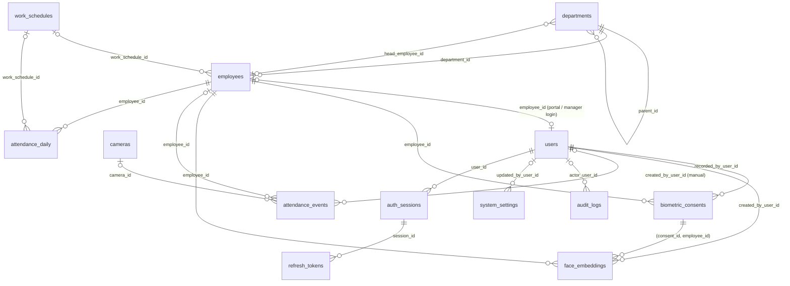

# Database Schema — AI Employee Attendance

> Status: **Implemented.** Revisions `0001` (Phase 3, 11 tables), `0002` (Phase 4: roles, `auth_sessions`, `refresh_tokens`), `0003` (Phase 5: photos, consent documents, duplicate prevention), `0004` (Phase 6: attendance engine).
> PostgreSQL 16+ (developed and tested on 17.6). SQLAlchemy 2.1 (async, asyncpg) + Alembic.
> Source of truth: models in [apps/api/app/models/](apps/api/app/models/) and migration
> [0001](apps/api/migrations/versions/20261107_2027_0001_initial_schema.py), [0002](apps/api/migrations/versions/20261107_2200_0002_auth_roles_sessions.py). This document describes them.

## 1. Conventions

| Rule | Detail |
|------|--------|
| Primary keys | `uuid` **UUIDv7** (time-ordered, generated in the app) for entities. `bigint GENERATED ALWAYS AS IDENTITY` for high-volume append tables (`attendance_events`, `audit_logs`). |
| Timestamps | `timestamptz` in UTC. Every connection sets `timezone=UTC`. Mutable tables have `created_at` and `updated_at`; `updated_at` is maintained by the **`set_updated_at()` trigger**, so it can't be forgotten or forged. |
| Status fields | Native PostgreSQL ENUMs (§3). Changing them requires a migration. |
| Soft delete | `deleted_at` on `departments`, `employees`, `cameras`. Unique names apply only among non-deleted rows (partial unique indexes). **Biometric data is hard-deleted.** |
| Naming | `pk_<table>`, `fk_<table>_<col>_<ref>`, `uq_<table>_<cols>`, `ix_<table>_<cols>`, `ck_<table>_<name>` (SQLAlchemy naming convention, so migrations are deterministic) |
| Durations | Integer **minutes** |
| Encrypted columns | Suffix `_enc`, type `bytea`, layout `key_id(2B) ‖ nonce(12B) ‖ ciphertext ‖ tag(16B)`, AES-256-GCM (§6) |
| Driver | `postgresql+asyncpg`. psycopg's async mode does not work with the default Windows event loop (found and fixed in Phase 3). |

## 2. Entity relationship diagram



### Foreign key delete behaviour

| FK | ON DELETE | Why |
|----|-----------|-----|
| employees.department_id → departments | RESTRICT | A department with staff can't vanish |
| departments.parent_id → departments | RESTRICT | Tree integrity |
| departments.head_employee_id → employees | SET NULL | Head leaves, department stays |
| employees.work_schedule_id → work_schedules | SET NULL | Deleting a schedule unassigns it |
| users.employee_id → employees | RESTRICT | Login accounts are deactivated, not orphaned |
| biometric_consents.employee_id → employees | RESTRICT | Consent is legal proof |
| face_embeddings.employee_id → employees | CASCADE | Biometrics never outlive the person |
| face_embeddings (consent_id, employee_id) → biometric_consents (id, employee_id) | CASCADE | **Composite FK:** an embedding's consent must belong to the same employee |
| attendance_events.employee_id / camera_id / created_by_user_id | RESTRICT | Attendance history is preserved |
| attendance_daily.employee_id → employees | RESTRICT | Timesheet history is preserved |
| attendance_daily.work_schedule_id → work_schedules | SET NULL | |
| audit_logs.actor_user_id → users | RESTRICT | Audit trail is never broken |
| system_settings.updated_by_user_id → users | SET NULL | |
| auth_sessions.user_id → users | CASCADE | Sessions are meaningless without the user |
| refresh_tokens.session_id → auth_sessions | CASCADE | |

## 3. Enum types

| Enum | Values |
|------|--------|
| `user_role` | `SUPER_ADMIN`, `ADMIN`, `VIEWER` (since `0002`; `0001` had HR_ADMIN/MANAGER/SECURITY_OPERATOR/EMPLOYEE, mapped HR_ADMIN→ADMIN and the rest→VIEWER) |
| `employee_status` | `ACTIVE`, `ON_LEAVE`, `SUSPENDED`, `TERMINATED` |
| `attendance_method` | `FACE`, `MANUAL` (employees who decline biometrics) |
| `camera_vendor` | `HIKVISION`, `DAHUA`, `GENERIC_ONVIF`, `GENERIC` |
| `camera_direction` | `IN`, `OUT`, `BOTH`, `NONE` |
| `camera_status` | `DRAFT`, `ACTIVE`, `DEGRADED`, `OFFLINE`, `DISABLED` |
| `event_source` | `CAMERA`, `MANUAL`, `IMPORT` |
| `recognition_decision` | `MATCHED`, `UNKNOWN`, `AMBIGUOUS`, `SPOOF_SUSPECTED` |
| `punch_direction` | `IN`, `OUT` |
| `attendance_status` | `PRESENT`, `LATE`, `INCOMPLETE`, `ABSENT`, `LEAVE`, `HOLIDAY`, `WEEKEND`, `NOT_SCHEDULED` |
| `actor_type` | `USER`, `SERVICE`, `SYSTEM` |

## 4. Tables (13)

Legend: **PK** primary key · **FK** foreign key · **U** unique · **NN** not null · **IX** index · **D** default

### 4.1 `users` — system login accounts
| Column | Type | Constraints |
|--------|------|-------------|
| id | uuid | PK |
| username | citext | U, NN, format `^[A-Za-z0-9_.@-]{3,64}$` |
| email | citext | U |
| password_hash | text | NN, **must start with `$argon2id$`** |
| role | user_role | NN |
| employee_id | uuid | FK employees, U. Optional link of a login account to an employee record |
| mfa_secret_enc | bytea | encrypted TOTP secret. Required when `mfa_enabled` |
| mfa_enabled / is_active | bool | NN, D false / true |
| failed_login_count | smallint | NN, D 0, ≥ 0 |
| locked_until, last_login_at | timestamptz | |
| password_changed_at | timestamptz | NN, D now() |
| locale | varchar(5) | NN, D `uz`, ∈ {uz, ru, en} |
| created_at / updated_at | timestamptz | NN |

Permissions per role are defined in code ([app/auth/permissions.py](apps/api/app/auth/permissions.py)), not in the database.

### 4.2 `departments`
| Column | Type | Constraints |
|--------|------|-------------|
| id | uuid | PK |
| parent_id | uuid | FK departments, IX, ≠ id |
| name | varchar(200) | NN, not blank. **Unique per parent (case-insensitive) among non-deleted rows** |
| code | varchar(50) | U |
| head_employee_id | uuid | FK employees (SET NULL) |
| work_schedule_id | uuid | FK work_schedules (RESTRICT), IX. Default schedule for the department **subtree** (`0004`) |
| created_at / updated_at / deleted_at | timestamptz | |

### 4.3 `work_schedules` — fixed weekly schedule (v1)
| Column | Type | Constraints |
|--------|------|-------------|
| id | uuid | PK |
| name | varchar(120) | U, NN |
| timezone | varchar(64) | NN, D `Asia/Tashkent` (IANA name) |
| start_time / end_time | time | NN, different. `end <= start` means the shift crosses midnight |
| working_days | smallint[] | NN, D `{1,2,3,4,5}`, ISO weekdays ⊆ {1..7}, 1–7 items |
| break_minutes | int | NN, D 60, 0–720 |
| grace_in_minutes / grace_out_minutes | int | NN, D 5 / 0, 0–240 |
| early_window_minutes / late_window_minutes | int | NN, D 180 / 360, 0–720 (work-date assignment) |
| overtime_enabled / is_active | bool | NN |
| created_at / updated_at | timestamptz | |

### 4.4 `employees`
| Column | Type | Constraints |
|--------|------|-------------|
| id | uuid | PK |
| employee_code | varchar(50) | U, NN, `^[A-Za-z0-9_.-]{1,50}$`, **must be upper-case** (since `0003`) |
| last_name / first_name | varchar(100) | NN, not blank |
| middle_name | varchar(100) | |
| search_name | text | **generated** `lower(last first middle)`, GIN trigram IX |
| department_id | uuid | FK, NN, IX |
| work_schedule_id | uuid | FK, IX |
| position_title | varchar(150) | |
| phone | varchar(20) | `^\+?[0-9]{7,15}$`. **Unique among non-deleted** (partial index, `0003`) |
| email | citext | basic format check. **Unique among non-deleted**, case-insensitive (`0003`) |
| hire_date | date | NN |
| termination_date | date | ≥ hire_date. **Set if and only if** status = TERMINATED |
| status | employee_status | NN, D ACTIVE, IX |
| attendance_method | attendance_method | NN, D FACE. `MANUAL` = non-biometric alternative |
| photo_key | varchar(512) | Encrypted profile-photo file in storage (`0003`). **Not used for recognition.** |
| photo_updated_at | timestamptz | Set iff `photo_key` is set |
| created_at / updated_at / deleted_at | timestamptz | |

**Data minimisation:** the database stores no national ID or passport, birth date, home address or gender. Phone and email are optional. A profile photo was added at the owner's request in Phase 5. It is optional, stored encrypted, re-encoded without EXIF, and never used for face recognition.

### 4.5 `biometric_consents`
| Column | Type | Constraints |
|--------|------|-------------|
| id | uuid | PK, U(id, employee_id) as the composite FK target |
| employee_id | uuid | FK, NN, IX. **Partial unique: one active (non-revoked) consent per employee** |
| consent_text_version | varchar(32) | NN |
| granted_at | timestamptz | NN, D now() |
| revoked_at | timestamptz | ≥ granted_at |
| revocation_reason | text | required when revoked |
| signed_document_key | varchar(512) | reference to the encrypted signed form (file storage). A consent is **documented** only when this is set. |
| document_content_type | varchar(64) | `application/pdf` or `image/jpeg`. Set together with the key (`0003`) |
| document_uploaded_at | timestamptz | Set together with the key (`0003`) |
| recorded_by_user_id | uuid | FK users, NN |
| created_at | timestamptz | NN |

### 4.6 `face_embeddings`
| Column | Type | Constraints |
|--------|------|-------------|
| id | uuid | PK |
| employee_id | uuid | FK (CASCADE), NN, IX |
| consent_id | uuid | NN, IX, composite FK with employee_id |
| model_id | varchar(64) | NN, IX (templates of different models are not comparable) |
| dim | smallint | NN, ∈ {128, 256, 512, 1024} |
| embedding_enc | bytea | NN, **length = 30 + dim × 4** (exact AES-GCM layout) |
| key_id | smallint | NN, > 0, **must equal the first 2 bytes of `embedding_enc`** |
| quality_score | real | NN, 0–1 |
| is_active | bool | NN, D true |
| gallery_version | bigint | NN, IX, from sequence `face_embeddings_gallery_version_seq`, bumped on every update |
| created_by_user_id | uuid | FK users, NN |
| created_at / updated_at | timestamptz | |

No face images are stored in the database. Whether enrollment photos are kept at all is decision **D3** (pending). If kept, they go to encrypted file storage, not here.

### 4.7 `cameras`
| Column | Type | Constraints |
|--------|------|-------------|
| id | uuid | PK |
| name | varchar(120) | NN, **unique case-insensitive among non-deleted** |
| location | varchar(200) | |
| vendor | camera_vendor | NN, D GENERIC |
| model | varchar(100) | |
| provider | camera_provider | NN, D RTSP. `RTSP` / `USB` / `TEST` (0005) |
| host | varchar(255) | `^[A-Za-z0-9.:-]+$` (IPv4/IPv6/hostname, no injection characters); required for RTSP |
| rtsp_port / onvif_port | int | 1–65535, rtsp D 554 |
| main_stream_path / sub_stream_path | varchar(512) | **must not contain `@` or `://`** (no credentials in URLs); main required for RTSP |
| device | varchar(32) | USB only: `0`–`99` or `/dev/videoN` (0005) |
| username_enc / password_enc | bytea | both or neither, ≥ 30 bytes (ciphertext only), RTSP only |
| direction | camera_direction | NN, D NONE |
| recognition_enabled / is_enabled | bool | NN, D true / false |
| status | camera_status | NN, D DRAFT, IX |
| roi | jsonb | JSON array (normalised polygon) |
| settings | jsonb | NN, D `{}`, JSON object |
| config_version | int | NN, D 1, ≥ 1 |
| last_seen_at | timestamptz | |
| last_error | text | sanitised, no credentials |
| runtime / runtime_reported_at | jsonb / timestamptz | last camera-service report (fps, frames, reconnects, resolution) (0005) |
| quality_status | camera_quality_status | NN, D UNTESTED. `UNTESTED` / `PASSED` / `FAILED` / `INCONCLUSIVE` (0005) |
| quality_tested_at / quality_report | timestamptz / jsonb | last stream quality test (no images) (0005) |
| created_at / updated_at / deleted_at | timestamptz | |

CHECK `ck_cameras_provider_fields`: RTSP needs host + main path; USB needs device; only RTSP may hold credentials.

### 4.8 `attendance_events`
One row per attendance-relevant event: camera sightings (matched or not) and manual or imported punches. Rows are **voided, never deleted**.

| Column | Type | Constraints |
|--------|------|-------------|
| id | bigint identity | PK |
| event_uid | uuid | U, NN (producer idempotency key, so stream redelivery cannot duplicate) |
| event_time | timestamptz | NN, BRIN IX |
| source | event_source | NN |
| employee_id | uuid | FK |
| camera_id | uuid | FK |
| decision | recognition_decision | camera events only |
| direction | punch_direction | |
| work_date | date | assigned by the attendance engine |
| counts_for_attendance | bool | NN, D false |
| similarity / second_similarity | real | −1…1 |
| liveness_score / quality_score | real | 0…1 |
| track_id | varchar(64) | |
| face_bbox | jsonb | |
| snapshot_key | varchar(512) | reference to an encrypted face crop. Nulled by retention |
| model_id | varchar(64) | |
| is_voided | bool | NN, D false. `void_reason` required when true |
| created_by_user_id | uuid | FK users (manual entries) |
| note | text | |
| ignore_reason | varchar(32) | Set **iff** not counted: UNMATCHED, DEBOUNCED, REPEATED_DETECTION, DUPLICATE_IN, OUT_WITHOUT_IN, OUT_OF_SEQUENCE, MONITOR_ONLY, EMPLOYEE_INACTIVE, NOT_BIOMETRIC, OUTSIDE_EMPLOYMENT (`0004`) |
| correction_id | uuid | IX. Required for MANUAL events. Groups one correction (= `audit_logs.entity_id`) (`0004`) |
| voided_at / voided_by_user_id | timestamptz / uuid FK users | Set together with `is_voided` (`0004`) |
| created_at | timestamptz | NN |

Row rules (CHECK):

| Rule | Constraint |
|------|-----------|
| CAMERA events have camera_id, decision, model_id | `camera_event_fields` |
| MANUAL/IMPORT events have employee, direction, author and no decision | `manual_event_fields` |
| MATCHED ⇒ employee set | `matched_has_employee` |
| UNKNOWN/AMBIGUOUS/SPOOF ⇒ **no** employee | `unmatched_has_no_employee` |
| Counted ⇒ employee, direction, work_date set, and MATCHED or manual | `counted_event_complete` |
| `ignore_reason` set exactly when not counted. Known values only | `ignore_reason_iff_not_counted`, `ignore_reason_known` |
| Voided ⇒ reason, time and user | `void_has_reason`, `void_fields_together` |
| MANUAL ⇒ correction_id | `manual_has_correction` |
| **No two counted, non-voided punches of an employee at the same instant** | partial unique `uq_attendance_events_counted_instant` |

Indexes: `(employee_id, event_time DESC)`, `(camera_id, event_time DESC)`, partial `(employee_id, work_date) WHERE counted AND NOT voided`, partial review queue `(decision, event_time DESC) WHERE decision IN (UNKNOWN, AMBIGUOUS, SPOOF_SUSPECTED)`, BRIN on `event_time`.

### 4.9 `attendance_daily`
| Column | Type | Constraints |
|--------|------|-------------|
| id | uuid | PK |
| employee_id | uuid | FK, NN. **U(employee_id, work_date)** |
| work_date | date | NN |
| work_schedule_id | uuid | FK (schedule applied that day) |
| scheduled_start / scheduled_end | timestamptz | end > start |
| scheduled / worked / late / early_leave / overtime _minutes | int | NN, D 0, 0–2880 |
| first_in / last_out | timestamptz | last_out ≥ first_in |
| status | attendance_status | NN. PRESENT/LATE ⇒ first_in set. ABSENT ⇒ no first_in and 0 worked |
| has_manual_events | bool | NN |
| computed_at | timestamptz | NN |
| engine_version | varchar(32) | NN (reproducible recomputation) |
| created_at / updated_at | timestamptz | |

IX `(work_date, status)` for the daily board.

### 4.10 `audit_logs` — append-only
| Column | Type | Constraints |
|--------|------|-------------|
| id | bigint identity | PK |
| created_at | timestamptz | NN, BRIN IX |
| actor_type | actor_type | NN. USER ⇒ actor_user_id. SERVICE ⇒ actor_service |
| actor_user_id | uuid | FK users, IX(actor_user_id, created_at DESC) |
| actor_service | varchar(64) | |
| action | varchar(64) | NN, `^[A-Z][A-Z0-9_]+$`, IX(action, created_at DESC) |
| entity_type / entity_id | varchar(64) | IX(entity_type, entity_id) |
| changes | jsonb | JSON object `{field: [old, new]}` |
| ip | inet | |
| user_agent | varchar(512) | |
| request_id | varchar(64) | |

### 4.11 `system_settings`
| Column | Type | Constraints |
|--------|------|-------------|
| key | varchar(128) | PK, dotted lowercase `area.name` |
| value | jsonb | NN |
| description | text | |
| updated_by_user_id | uuid | FK users (SET NULL) |
| created_at / updated_at | timestamptz | |

Seeded with 11 defaults from [API_CONTRACTS.md §2.11](API_CONTRACTS.md) (`0001` seeded 12; `0002` removed `security.session_days`, because session lifetime is environment configuration). `recognition.match_threshold = 0.45` is a **placeholder** until it's calibrated.

### 4.12 `auth_sessions` — one row per login (since `0002`)
| Column | Type | Constraints |
|--------|------|-------------|
| id | uuid | PK. Equals the `sid` claim in access tokens |
| user_id | uuid | FK users (CASCADE), NN. Partial IX `WHERE revoked_at IS NULL` |
| created_at | timestamptz | NN |
| expires_at | timestamptz | NN, > created_at, IX (absolute lifetime, `SESSION_DAYS`) |
| last_used_at | timestamptz | updated at most every 5 min |
| revoked_at / revoke_reason | timestamptz / varchar(32) | both set or both null. Reason ∈ LOGOUT, LOGOUT_ALL, PASSWORD_CHANGED, TOKEN_REUSE, ADMIN, DEACTIVATED |
| ip | inet | |
| user_agent | varchar(512) | |

### 4.13 `refresh_tokens` (since `0002`)
| Column | Type | Constraints |
|--------|------|-------------|
| id | uuid | PK |
| session_id | uuid | FK auth_sessions (CASCADE), NN, IX |
| token_hash | bytea | U, NN, **exactly 32 bytes** (SHA-256). The raw token is never stored |
| created_at / expires_at | timestamptz | NN, expires > created |
| used_at | timestamptz | set when rotated. A second use means theft, and the session is revoked |

## 5. Database-level protections (triggers)

| Trigger | Table | Effect |
|---------|-------|--------|
| `trg_<table>_updated_at` (8 tables) | mutable tables | `updated_at := now()` on every UPDATE |
| `trg_audit_logs_no_update_delete` | audit_logs | Rejects UPDATE/DELETE: *"audit_logs is append-only"* |
| `trg_audit_logs_no_truncate` | audit_logs | Rejects TRUNCATE |
| `trg_face_embeddings_require_consent` | face_embeddings | INSERT/UPDATE only if the employee has an **active consent with the signed form attached** (documented requirement since `0003`). Locks the consent `FOR SHARE` against concurrent revocation. |
| `trg_face_embeddings_gallery_version` | face_embeddings | Bumps `gallery_version` on every update |
| `trg_biometric_consents_guard` | biometric_consents | Identity fields immutable. A revoked consent is fully immutable. An active consent cannot be DELETEd |
| `trg_attendance_events_guard` | attendance_events | **Immutable events** (`0004`): only the void fields (and `snapshot_key`) may change. Un-voiding and DELETE are rejected. Corrections therefore always leave a trail. |
| `trg_biometric_consents_purge_on_revoke` | biometric_consents | On revocation, **deletes all embeddings of that consent in the same transaction** |

These rules hold even if application code has a bug or someone uses `psql` directly. Only the database owner or a superuser can disable a trigger, and that shows up in the PostgreSQL log.

## 6. Sensitive data protection

| Data | Protection |
|------|-----------|
| Face embeddings | AES-256-GCM, per-purpose subkey (HKDF-SHA256, info=`biometric-template`), **AAD = `face_embeddings:{id}:{employee_id}:{model_id}`**. A template copied to another row or employee fails to decrypt. A DB CHECK enforces exact ciphertext length, so a raw vector cannot be stored by mistake. Plaintext exists only in memory. |
| Camera credentials | Same scheme, subkey `device-credential`, AAD per row and field. CHECK requires ciphertext-sized values. Stream paths may not contain credentials. |
| MFA secrets | Column `users.mfa_secret_enc`, subkey `mfa-secret` (used from the auth phase) |
| Passwords | Argon2id hashes only (CHECK) |
| Keys | `DATA_ENCRYPTION_KEYS` (env / Docker secret, never in DB or repo). Keyring with ids allows **rotation**: new writes use the active id, old ids still decrypt. Losing the key loses the data, so back it up separately. |
| Audit log | `app.db.audit.record()` refuses fields named password, secret, token, embedding, vector, image, `*_enc` and binary values |
| ORM | `repr()` of models never prints ciphertext or vectors. Relationships use `lazy="raise"` (no hidden queries in async code) |

## 7. Transactions

[apps/api/app/db/session.py](apps/api/app/db/session.py):

| Helper | Use | Semantics |
|--------|-----|-----------|
| `get_session` | FastAPI dependency | One transaction per request: commit on success, rollback on any exception |
| `session_scope()` | workers and scripts | Same unit-of-work semantics |
| `savepoint(session)` | optional sub-step | SAVEPOINT: failure rolls back only that block |
| `audit.record()` | everywhere | Writes inside the caller's transaction, so the audit row commits or rolls back with the change |

Business code never calls `commit()` itself (DEVELOPMENT_RULES §4). Connection settings: `statement_timeout=30s`, `timezone=UTC`, `application_name=attendance-api`, `pool_pre_ping`.

## 8. Index summary

44 indexes in total (11 PKs, 9 unique constraints, 3 partial or expression unique indexes, 21 secondary), plus 58 CHECK constraints and 20 foreign keys. Query patterns:

| Query | Index |
|-------|-------|
| Employee search (Latin/Cyrillic, partial names) | GIN trigram on `employees.search_name` |
| Daily board | `attendance_daily (work_date, status)` |
| Employee timeline | `attendance_events (employee_id, event_time DESC)` |
| Day computation | partial `attendance_events (employee_id, work_date) WHERE counted AND NOT voided` |
| Unknown-face review | partial `attendance_events (decision, event_time DESC)` |
| Time-range scans on big tables | BRIN on `attendance_events.event_time`, `audit_logs.created_at` |
| Gallery delta sync | `face_embeddings (gallery_version)` |

## 9. Changes vs the Phase 1 design

The owner's Phase 3 scope named 11 tables. Differences from the original design:

| Phase 1 design | Implemented | Reason |
|----------------|-------------|--------|
| `face_templates` | `face_embeddings` | Owner naming. Also linked to the authorising consent (composite FK) |
| `recognition_events` + `attendance_punches` | `attendance_events` (one table) | Owner naming. One table with CHECK rules per source is simpler and still strict |
| `attendance_days` | `attendance_daily` | Owner naming |
| `work_schedules` + `schedule_rules` + `employee_schedules` | `work_schedules` (fixed weekly) + `employees.work_schedule_id` | Within the 11-table scope. Per-day rules, rotations and assignment history come with the attendance engine |
| `users.managed_department_ids uuid[]` | removed | Arrays can't be FK-checked. Scope comes from `departments.head_employee_id` |
| `employees.site_id`, `positions` table | `position_title` text, no sites | Not in scope. Single site for now |
| `employees.biometric_status` (denormalised) | removed | Derived from consents and embeddings. Avoids drift |
| Monthly partitioning of events/audit | BRIN indexes, no partitions yet | Partitioning complicates FKs and is unnecessary below ~10M rows. Revisit at scale |

**Deferred tables** (added by later phases with their features): `service_clients` (service-to-service auth); `enrollment_images` (if D3 = keep); `gallery_tombstones` (delta sync, if a full reload proves too slow); `holidays`, `leave_types`, `leave_requests`, `attendance_corrections`, `schedule_rules`, `employee_schedules` (attendance engine); `report_exports` (reports); `sites` (multi-site).

## 10. Data retention

| Data | Default | Mechanism |
|------|---------|-----------|
| Face embeddings | While consent is active. Deleted **immediately** on revocation (trigger). +7 days after termination (job, later phase) | DB trigger + retention job |
| Snapshots (`snapshot_key`) | 30 days matched, 7 days unknown | Retention job (Phase 7+) |
| attendance_events rows | 12 months | Retention job |
| attendance_daily | Per labour law (≥ 5 years, to confirm) | — |
| audit_logs | ≥ 3 years | Owner-run archival (append-only for the app) |

## 11. Initialisation and migrations

See [README.md § Database](README.md#database). In short:

```bash
npm run db:init       # once: create role + database on your PostgreSQL (asks for the postgres password)
npm run db:migrate    # create/upgrade tables (alembic upgrade head)
npm run db:current    # show applied revision
npm run db:check      # verify models and migrations match
npm run db:revision -- "describe change"   # new autogenerated migration (review it!)
```
